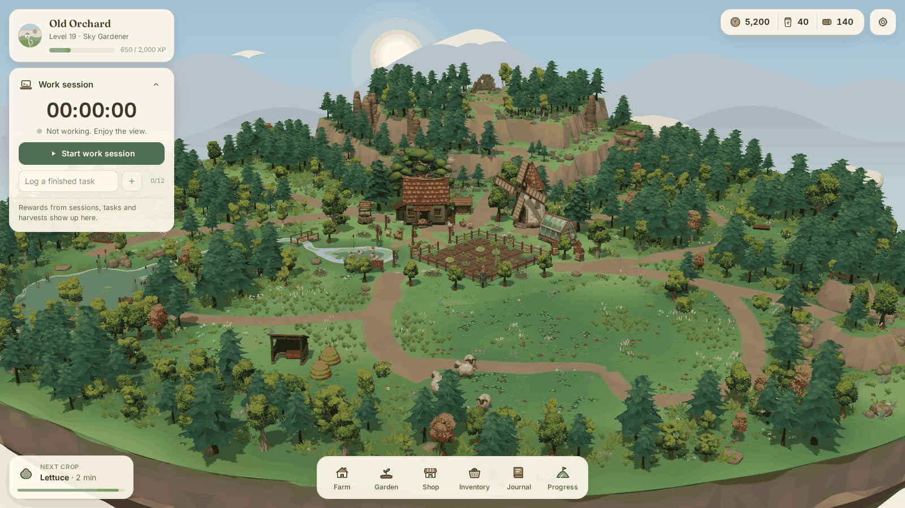
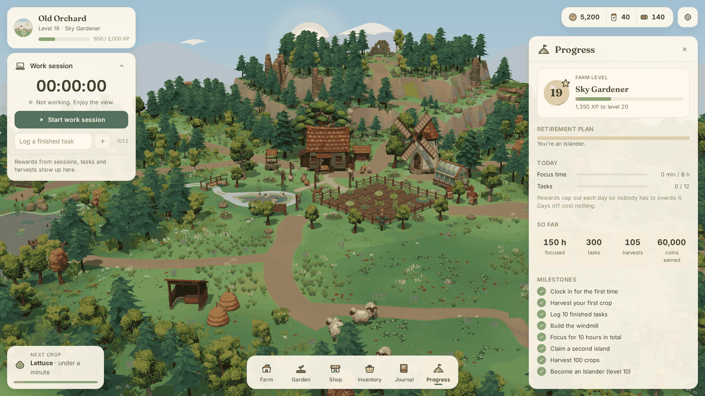

# Gitaway

**Commit code. Escape to the countryside.**

Gitaway is an ambient farming game for developers. A small island floats above a sea of clouds, and your real work slowly turns it into the farm you keep promising to retire to. Work sessions earn coins, finished tasks earn small bonuses, crops grow while you work (and while the game is closed), and the island fills up with gardens, animals, buildings and eventually neighbouring islands.

It is meant to sit beside a workday: quiet, slow, and happy to be ignored for hours.





## Run it

You need Node 22 or newer.

```bash
npm install
npm run dev          # http://127.0.0.1:5173
```

Other scripts:

| Script | What it does |
|---|---|
| `npm run build` | Type-checks and builds to `dist/` (a static site with no backend) |
| `npm run build:devtools` | The same build with the Dev tools switched on (see below); it's what the "Gitaway Dev" desktop app is made from |
| `npm run preview` | Serves the production build at http://127.0.0.1:4173 |
| `npm test` | Unit tests for the game rules (Vitest) |
| `npm run balance` | The balance simulator: plays a worker and a farmer through the economy and checks its targets, T1–T7. Local only: it isn't part of `npm test` and CI never runs it |
| `npm run e2e` | End-to-end tests against the production build (Playwright, desktop and mobile) |
| `npm run e2e:mobile` | Just the phone-sized e2e project |
| `npm run check:push` | What a push that changes the game has to pass: the type check, the unit tests and both e2e projects, side by side (see below) |
| `npm run type-check` | TypeScript only |

The first e2e run needs a browser: `npx playwright install --only-shell chromium`.

### What runs where

- **CI** (GitHub Actions) runs the type check, the unit tests and the production build, and the desktop shell's Rust tests. It doesn't run Playwright at all; the `CI` settings left in `playwright.config.ts` only apply if you set `CI=1` yourself.
- **Your machine runs the e2e suite**, before each push that changes the game. A git hook (`.githooks/pre-push`, which `npm install` switches on) runs `npm run check:push`: the type check, the unit tests, and the e2e suite on both projects, all at once. The first to fail stops the others, and the push. An e2e test that fails is run once more and only counts if it fails again; one that passes the second time is reported as flaky.
- **A pass is remembered.** When `npm run check:push` passes on committed code, it leaves a pass stamp for that exact code (in `.git/e2e-pass/`, which every worktree shares), and pushing code that has a stamp goes straight through. The checks test the files on disk, so the hook checks a push of the commit you have checked out, with your changes committed, removed or stashed (`git stash -u`).
- **Run `npm run check:push` before a long push.** The hook only runs once git has connected to GitHub, and a connection can drop during a long check. If a push fails after the checks have passed, push again: the stamp makes it instant.
- **Docs, art and models skip the checks.** A push that only changes `docs/`, `art/`, `public/models/`, `.github/` or Markdown files goes straight through, so art pushes stay instant. The next push that touches the game checks the whole tree, models included.
- The e2e run waits its turn on `/tmp/gitaway-e2e.lock` while another run on the machine holds it, and serves the build on a free port from 4300 to 4399 (or on `E2E_PORT`).

Development builds (`npm run dev`, `npm run desktop:dev`) have a small **Dev** tab on the right edge for trying things quickly: it grants coins, wood and a level, and moves the game clock ahead by an hour, eight hours or a day, as if the time had passed (crops ripen, the recap and visitors catch up). Skipped time is kept across reloads and cleared by erasing the farm. Production builds leave the tab and its code out entirely, except the one made on purpose with `npm run build:devtools`: the **Gitaway Dev** desktop app (see [Gitaway Dev](#gitaway-dev-the-desktop-app-with-the-dev-tools)).

## How to play

1. **Clock in.** Start a work session when you start working. It earns 10 coins and 1 XP a minute, plus a piece of wood every 10 minutes. End the session to collect.
2. **Log tasks.** When you finish something, type it into the session card for a small bonus: 40 coins, 5 XP and 2 wood. Each task pays once a day.
3. **Garden.** Buy seeds in the shop and plant them from the garden panel, or click a plot on the island. Crops ripen on real time, even while the game is closed, and each suits a different time away: radishes in 5 minutes, cranberries in 4 hours, blueberries in 5 hours (plant before lunch, pick before home time), lavender in 10 hours, overnight. A crop that differs from the one its plot last grew sells for 25% more: fresh soil. Repeating a crop just pays its normal price.
4. **Collect.** The farm makes things on its own: hens and ducks lay, sheep grow fleeces, goats give milk, bees fill jars, fruit trees drop fruit, the wetland lands fish, and the woodshed (50 coins) stacks wood, twice as much once you own the forest grove. Each kind fills for up to 3 days' worth and then simply stops filling; **Collect all** brings it in as coins, a little XP and wood.
5. **Build.** Spend coins and wood on flower beds, lanterns, animals, a windmill, a greenhouse, and seven pieces of land, which rise out of the clouds when you claim them. Land opens in any order at one price that rises with each piece you own: the first is 100 coins and 8 wood, the seventh 2,872 coins and 120 wood. Everything you buy appears on the island.
6. **Level up.** Sessions, tasks, harvests, collecting and building earn XP. Every level from 2 to 12 unlocks a crop, an animal or something to build. A cat moves in at level 2, and a dog wanders up at level 5.

Working alongside the farm pays about 2.5 times what the farm makes by itself, and a worker with two hours of sessions and four tasks a weekday owns the whole island in about two weeks. A player who doesn't work gets there too, in six or seven weeks. The numbers are tuned with a local simulator, `npm run balance` (see [the idle economy spec](docs/superpowers/specs/2026-10-22-idle-economy-design.md)).

Keyboard: the number keys open the tools in toolbar order (`1`–`5`: Farm, Garden, Shop, Inventory and Progress). `Esc` closes a panel. Drag to turn the island, and scroll to zoom.

The idle loop ([`docs/idle-loop.md`](docs/idle-loop.md)) arrives one feature at a time. Each has a switch in [`src/game/features.ts`](src/game/features.ts); while it's off, nothing of that feature shows.

### Fair by design

- A single session earns for at most 4 hours, and credited focus time caps at 8 hours per day. Beyond that a session still runs, but just for the joy of it.
- Each task title pays once per day, up to 12 tasks, and the desktop app counts up to 20 commits a day (merges are ignored). A repeated title or a task over the limit pays nothing, wood included.
- Ending a session twice, or clicking repeatedly, can't pay twice: every action is a pure state transition that refuses invalid moves.
- A session whose clock runs backwards earns nothing, and sessions shorter than a minute earn nothing.
- Work and the farm are separate streams: nothing you own changes what work pays, and working doesn't speed the farm up.
- Nothing is ever lost for inactivity. Nothing decays, spoils or expires, and there are no streaks, no wilting and no feeding. What the farm makes stops filling at 3 days' worth of each kind and waits for you; nothing already made is taken away, and ripe crops wait as long as it takes. Take a holiday.

All the numbers live in [`src/game/config.ts`](src/game/config.ts).

## Privacy

- There is no account, no analytics and no tracking. The production build ships a Content-Security-Policy that only allows its own origin, so it **cannot** talk to other hosts, and an e2e test checks this.
- The farm, sessions and task titles are stored in this browser's IndexedDB, on this device only. While a save is still being written, a short-lived backup copy is also kept in this browser's localStorage, so leaving the page mid-save loses nothing; the save removes it once it lands. Settings → Privacy can export a copy or erase everything (after a confirmation).
- Ambient sound is off by default. It's synthesised in the browser, so nothing is downloaded.

## Work integrations

Manual sessions and tasks are the core of the game, and they always work.

[`src/integrations/sources.ts`](src/integrations/sources.ts) defines the boundary for other activity sources. They can only ever report counts and timestamps, never code, diffs, commit messages, file names or credentials. In the Settings panel:

- **Local Git activity** works in the desktop app, on Windows and macOS (see below). In a browser it says *Desktop app only*, because a web page can't read local repositories, so it stays off rather than pretending.
- **GitHub and GitLab** say *Not available yet*. When they're built, they should use each provider's official app or OAuth flow with read-only scopes and disconnect controls, never personal access tokens.

Nothing in the UI shows a fake connection.

### Commit tracking in the desktop app

In the desktop app, Settings → Work tracking → **Add repository…** lets you pick folders that are Git repositories. While Gitaway is open, it checks them when it starts, every two minutes, and when you come back to the window (at most every 30 seconds). Each check runs `git log` with a 20-second time limit.

- **What counts:** only *your* commits (author email equals that repository's `user.email`) made after you added the repository, on your local branches, excluding merges and empty commits (ones that change no files). Remote-tracking branches, tags and stashes are ignored, and history from before you connected never pays out.
- **No double pay:** a commit's time is the earlier of its author and commit dates, so rebasing, amending or cherry-picking work that was already counted doesn't pay again. A commit dated ahead of the clock counts the first time it's seen, and its author time is remembered so neither it nor an amended copy pays again when that date arrives. A commit reached from two watched folders (two worktrees or clones of one repository) is counted once, by whichever is checked first; the other passes over it. Picking a subfolder resolves to the repository's top folder, so a repository can't be watched twice.
- **Rewards:** each new commit pays 20 coins and 3 XP, for up to 20 commits a day across all repositories, counted on the day Gitaway first sees it. Commits over the cap are skipped rather than saved up.
- **What is read:** a small Rust module ([`src-tauri/crates/git-activity`](src-tauri/crates/git-activity)) runs `git log` locally and hands the game only numbers for each repository: how many new commits there are, when the newest was made, the author times of any counted ahead of the clock (`ahead`), and how many were passed over because another watched folder counted them (`passed`). It reads each commit's hash only to tell commits apart, in memory; code, diffs, commit messages, hashes and file names never leave it, and nothing goes over the network. Git runs with signature checks and file-system monitors turned off, so a repository's own settings can't make it start other programs.
- **What is stored:** the repository path you picked is saved with your farm on this device, so it can be checked again, along with any `ahead` author times. **Export farm** leaves the paths out. Remove a repository in Settings to stop watching it.

### Building the desktop app

The Windows installer is built by GitHub Actions (`.github/workflows/desktop.yml`) whenever the desktop code changes, or on demand from the Actions tab. Download it from the run's **gitaway-windows-installer** artifact. It is unsigned for now, so Windows SmartScreen asks you to confirm the first time. The Mac apps come from a workflow of their own (see [The Mac apps](#the-mac-apps-apple-silicon-and-intel)).

Building locally needs Rust. Either install it on Windows (rustup, plus Visual Studio Build Tools with the C++ workload) and run `npm run desktop:build`, or cross-compile from WSL with `cargo-xwin`. The Rust tests for the Git module run anywhere with `cargo test --manifest-path src-tauri/Cargo.toml -p git-activity`.

#### Gitaway Dev: the desktop app with the Dev tools

The same workflow builds a second installer, **Gitaway Dev**, for trying the game out quickly on Windows. It is the normal app with the Dev tools switched on: a **Dev** tab on the right edge of the window that grants coins, wood and a level, and moves the game clock ahead by an hour, eight hours or a day. The normal installer never contains any of that code.

To get it:

1. On GitHub, open the repository's **Actions** tab, then the **desktop** workflow, then **Run workflow** and pick the branch. It builds by itself only when the native side (`src-tauri/`) changes, so for the game's latest code start a run rather than picking an old one.
2. At the bottom of the run, under **Artifacts**, download **gitaway-windows-dev-installer** (a zip, kept for 7 days). The normal installer is **gitaway-windows-installer**, in the same place.
3. Unzip it and run `Gitaway Dev_<version>_x64-setup.exe`. It is unsigned, so SmartScreen asks you to confirm: **More info**, then **Run anyway**.
4. Start **Gitaway Dev** from the Start menu. The window is titled "Gitaway (dev tools)". Click the **Dev** tab on the right edge to open the panel.

It installs beside Gitaway, not over it, with its own folder, Start menu entry and uninstaller. To Windows it is a different app (`dev.gitaway.desktop.devtools`), so it also keeps its own app data, and **its own farm**: skipping time there never touches the farm in the normal app. Skipped time is kept across restarts and cleared by erasing the farm, as in a browser.

How it works: `npm run build:devtools` is `vite build --mode devtools`, which sets the `__DEV_TOOLS__` constant (see [`vite.config.ts`](vite.config.ts)) that the Dev panel and the clock's time skips are behind. Every other build sets it to `false`, so the minifier removes them. [`src-tauri/tauri.devtools.conf.json`](src-tauri/tauri.devtools.conf.json) is merged over `tauri.conf.json` for that installer: the name, the identifier, the window title and the build command. To build it locally: `npx tauri build --config src-tauri/tauri.devtools.conf.json`. The workflow checks the web files of each installer with [`scripts/check-dev-tools.mjs`](scripts/check-dev-tools.mjs), so a normal installer with dev tools in it, or a dev one without, fails the run before anything is uploaded.

#### The Mac apps: Apple Silicon and Intel

A second workflow, **desktop (macOS)** ([`.github/workflows/desktop-macos.yml`](.github/workflows/desktop-macos.yml)), builds Gitaway and Gitaway Dev for Macs, as disk images. GitHub charges ten times as much for a macOS runner minute as for a Linux one on a private repository, so this workflow never starts by itself: it runs only when you start it. To get Mac apps of the current code:

1. On GitHub, open the repository's **Actions** tab, pick **desktop (macOS)** in the list of workflows, then **Run workflow**, choose the branch, and run it.
2. When it has finished, download the artifact for your Mac from the bottom of the run (each is a zip, kept for 14 days). Apple menu → **About This Mac** tells you which Mac you have: a **Chip** called Apple M1, M2, M3 or later is Apple Silicon; a **Processor** called Intel is Intel.

   | Your Mac | Gitaway | Gitaway Dev |
   |---|---|---|
   | Apple Silicon (M-series) | **gitaway-macos-arm64** | **gitaway-macos-arm64-dev** |
   | Intel | **gitaway-macos-x64** | **gitaway-macos-x64-dev** |

3. Unzip it (double-click) and open the `.dmg` inside. In the window that opens, drag **Gitaway** (or **Gitaway Dev**) onto **Applications**, then eject the disk image.
4. The apps are signed ad hoc, not with an Apple Developer ID, and they aren't notarized, so the first time you open one macOS refuses, saying it can't verify the app. Click **Done**, open **System Settings → Privacy & Security**, scroll down to the message about Gitaway and click **Open Anyway**, then confirm. After that the app opens normally. (On macOS 14 and earlier, Control-clicking the app and choosing **Open** also works.) Or, in Terminal:

   ```bash
   xattr -dr com.apple.quarantine "/Applications/Gitaway.app"       # or "/Applications/Gitaway Dev.app"
   ```

The apps need macOS 13.3 Ventura or later. A Mac app's web view is the Safari engine that comes with macOS, and the game's script needs Safari 16.4 or later (three.js uses JavaScript that older versions can't read), which came with macOS 13.3.

**Gitaway Dev** is a separate app in Applications, beside Gitaway, with its own name and bundle ID (`dev.gitaway.desktop.devtools`). macOS keeps a web view's storage per bundle ID, so it has **its own farm**: skipping time there never touches the farm in the normal app. Its window is titled "Gitaway (dev tools)", and the **Dev** tab is on the right edge of the window.

Commit tracking on a Mac uses the Git that comes with Apple's command line developer tools. If they aren't installed, macOS offers to install them when Gitaway first runs Git, and until they are, Gitaway says Git could not be run (`xcode-select --install` in Terminal installs them too). macOS may also ask once whether Gitaway may read a repository in your Documents, Desktop or Downloads folder.

Each run builds both apps for both kinds of Mac on Apple Silicon runners (Intel is cross-compiled), and [`scripts/check-macos-app.sh`](scripts/check-macos-app.sh) checks each app's bundle ID, processor, minimum macOS and signature before its disk image is uploaded. To build on a Mac yourself, install Rust and the command line developer tools, then run `npx tauri build --bundles dmg` (add `--config src-tauri/tauri.devtools.conf.json` for Gitaway Dev); the disk image lands in `src-tauri/target/release/bundle/dmg/`.

## How it's built

TypeScript, React 19, Vite, Three.js through React Three Fiber, Zustand, and IndexedDB (via `idb-keyval`).

```
src/
  game/          Pure, deterministic game rules: economy config, sessions, tasks,
                 crops, building, levels, save migration. Fully unit-tested.
  store/         Zustand store: applies game actions at the current time, toasts,
                 debounced saving, and cross-tab sync.
  world/         The 3D island. Procedural low-poly terrain and props, crops,
                 animals, water shaders, clouds, the day cycle, and the painted sky.
  ui/            HUD, panels, welcome, tour, illustrated icons.
  integrations/  Activity sources: manual sessions and tasks, and local Git
                 commits through the desktop app.
  audio/         Optional synthesised ambience.
src-tauri/       Desktop shell for Windows and macOS (Tauri 2), and the override
                 that makes the Gitaway Dev build. crates/git-activity holds the
                 only code that reads repositories.
e2e/             Playwright happy-path tests (fake clock for sessions and growth).
art/             3D asset brief and sources (see art/ASSETS.md).
public/models/   Exported .glb models and their manifest.
```

Rendering notes:

- The island, cliffs, plants and buildings are generated from code, so there are no image assets. Faces are flat-shaded and coloured per face for a painterly low-poly look.
- The camera looks down on the island and never sees the horizon. The distant mountains, sun, moon and stars are therefore painted into a CSS layer behind a transparent canvas, and their colours follow the time of day.
- Frames are drawn at about 30 fps (Lively), 15 fps (Calm), or only when something changes (Still, which is also what a reduced-motion preference gets). The world stops drawing entirely when the tab is hidden.
- Light follows the player's clock, from cool morning through warm afternoon and rosy evening to a blue night with lit windows and fireflies. It can be pinned to one time of day in Settings.

## Known limitations

- Placement is curated: each building or decoration has a designed spot (or a few). Free placement would be a bigger feature.
- Several open tabs stay in step through a BroadcastChannel, but two tabs acting in the same instant could still race.
- The game runs on the device's clock. Moving the clock forward can ripen crops early. Daily caps and the 4-hour session cap limit what that can earn.
- Hand-modelled 3D assets are in progress (see `art/ASSETS.md`). The procedural stand-ins are what ship today.

## Licence and credits

- **Code:** MIT (see `LICENSE`).
- **Music:** "Lofi Study Session", "Lofi Studying" and "Lofi Harp & Gamelan" by Freaq Studios, my own music. All rights
  reserved.
- **3D models and art:** made for this game, procedurally in code, in Blender, or with Meshy's image-to-3D tools, then
  unified in Blender. All rights reserved.
- **Trees and bushes:** reskinned from Quaternius' [Stylized Nature MegaKit](https://quaternius.com) (CC0); see
  `art/reskin/SOURCES.md`.
- **Fonts:** through Fontsource (SIL Open Font License).
