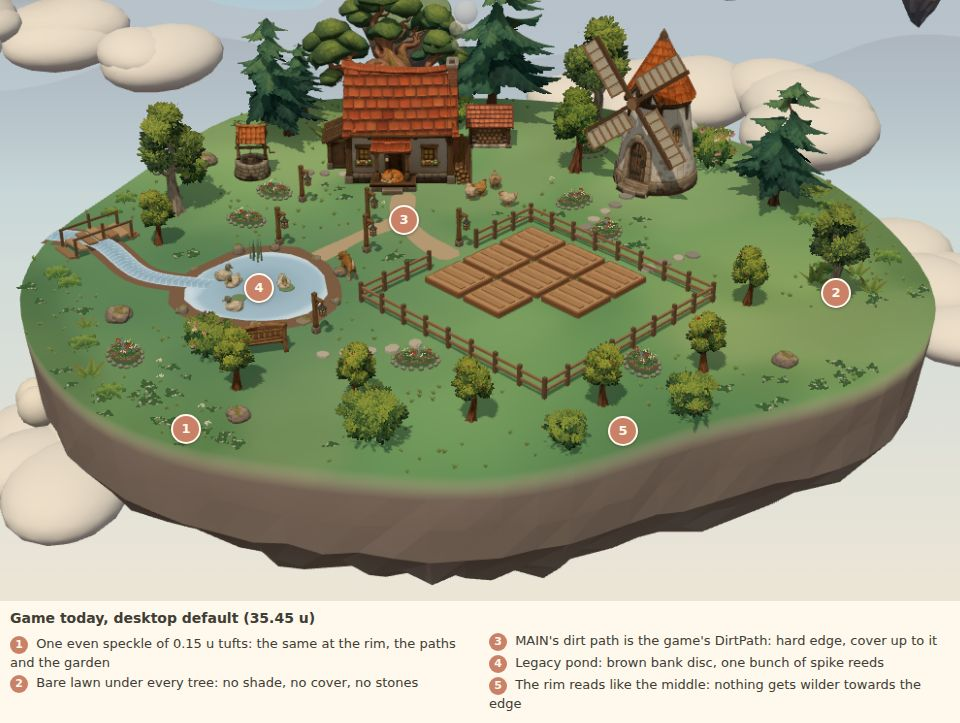
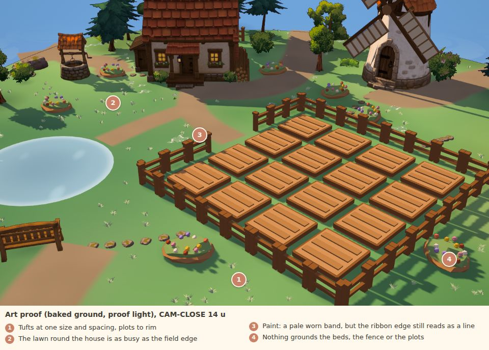
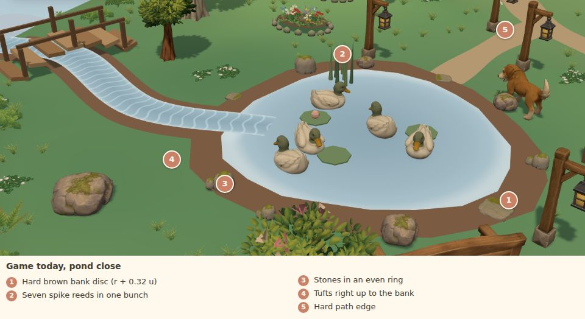
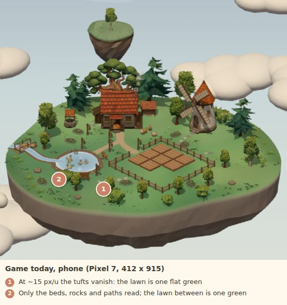
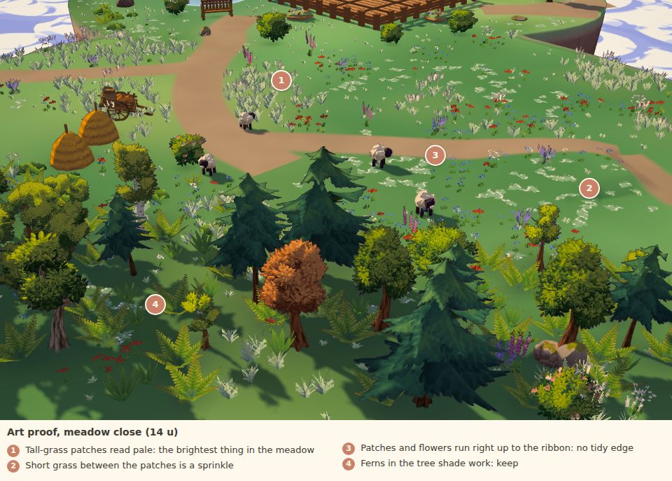

# Ground vegetation: design

Date: 2026-10-25 · Status: **approved by the owner on 2026-10-25, with the amendments under "Owner review"** · Branch
`art/ground-vegetation` (from `art/art-bible`, PR #60) · Plan: [2026-10-25-ground-vegetation-plan.md](2026-10-25-ground-vegetation-plan.md) ·
Builds on [2026-10-22-flowers-living-ground-design.md](2026-10-22-flowers-living-ground-design.md) (the plant kit and the patch
field, merged) · Rules: [../ART-BIBLE.md](../ART-BIBLE.md), [../ASSET-RULES.md](../ASSET-RULES.md) §1–§3, [../VISUAL-QA.md](../VISUAL-QA.md)

## Owner review, 2026-10-25

The owner approved the design with five answers. The sections below are amended in place; this is the summary.

| # | The owner's answer | What changes |
|---|---|---|
| 1 | Design: "Yes but more patches of grass tufts." | Approved, with more and slightly larger **tuft patches** (short-grass clusters of 4–7 members within 0.2–0.35 u) in the open lawn's margins (the `lawn` zone), the wild edges (B) and between trees (C). A stays clear round the house, the garden plots, the paths and the interactables. The extra tufts come as clustered patches, never an even sprinkle (§3, §4). |
| 2 | Understory: "Shade, clover and pebbles". | Option (a): darker shade pools in the paint, dark clover and small pebbles under trees. No fallen leaves (they wait for a future seasons add-on) and no `moss_patch` (§4–§6). |
| 3 | "Keep the farm low". | No taller grass and no ferns anywhere on MAIN, its edges included: the 2026-10-22 "farm: no tall plants" rule stands. `grass_tall` and ferns stay on the wild pieces only (§4). |
| 4 | The extra draw calls (about +8 net, +18 worst case, against the ≤ 920 gate). | Accepted as part of the design (§5). |
| 5 | Lower cover test V3's floor only as far as the new item target needs. | V3's floor goes from 300 to **270 plants** (§4, §10). |

**The farm's item target: about 320 plants (300–340)**, pebbles not counted (they are stones, added in P3). Why:

- It fits the extra tuft patches. At the middles of the amended zone targets (§4) MAIN carries about 305 plants (B about 190, the
  rest 25–30 each); the target sits just above the middles, so the tuft patches B, C and the lawn gained are really there.
- It is about today's count on `main`: **362 / 337** (default / alt seed, measured on `main` 1b9feb3, where the teardrop pond and its
  stream took ground; the 388 of §2 is `art/art-bible`). So the change is where the plants stand, not how many there are: far fewer
  round the house and along the paths, more in patches at the edges and between trees. "Composition over quantity" still holds.

**V3's floor: 270 plants.** That is 10 % under the window's low end. The alt seed runs 7 % under the default today (337 against 362),
so a floor at 300 would fail a seed that lands at the bottom of the window. The floor goes down by 30, not the 100 of the draft.

**Taken as approved with the design** (the design's recommendations; no separate answer): `weed_rosette` in B, and the game's own
`Reeds` at the pond. The pond's reeds replace the game's 7 spike reeds there, so they add no new tall plant to the farm; `grass_tall`
×0.6 leaves MAIN's D mix.

**Order.** PRs #60 and #65 are both merged into `main` (3354a4a, cfdc571). The work starts from `main`, and P3's pond edge no longer
waits.

## 1. Goal and the owner's brief

The owner's art-direction brief of 2026-10-25 (the art session's copy, rebuilt from the controller's summary, is
`scratchpad/ground/brief.md`): make the grassy terrain read as a polished, living storybook meadow, not a flat green plane with
scattered objects, **through composition, subtle variation and cohesion, not more objects**. Keep the look: stylised low-poly,
painterly textures, soft light, muted greens. There are five density zones:

- **A** open lawn, clean round the farmhouse, the paths, the plots and the interaction spots;
- **B** wild meadow, richer at the perimeter, in corners and between tree groups, in irregular clusters;
- **C** tree understory: darker patches, small stones and cover, never rings;
- **D** water edges: reeds, stones and damp plants on selected stretches, keeping the pond's silhouette;
- **E** path edges: a soft dirt-to-grass edge, small stones, thinner grass.

Placement: clusters of 3–7, scale ±20–30 %, seeded, no repetition, nothing through paths, buildings, crops, the pond, animals or
interactables, nothing floating or clipping. Ground colour: low-frequency, no camo mottling, quiet under gameplay. Performance:
instancing, no per-frame work, no new dependency, and mobile stays fast.

> "Tidy around the farmhouse, productive around the garden, slightly wild around the edges. Composition over quantity, subtlety
> over contrast."

## 2. Current state (measured 2026-10-25 on `art/art-bible` a85fb3d)

The numbers come from a read-only probe of `composeBlueprint` and the published GLBs, sampled on a 0.1 u grid. The before shots
come from the art proof (`?baked=1`, the proof's light) and the game session's renders of the current game.

> On `main` (1b9feb3, after water rev 1) the farm's cover is 362 items at the default seed and 337 at the alt seed: the teardrop pond,
> its rerouted stream and flowerbed 8's new spot took ground. The zone areas below are a85fb3d's; plan Task 1 re-measures them on `main`.

**Why the ground reads flat:**

1. **The cover is one even sprinkle that ignores what is around it.** The farm has 388 kit items: 276 `grass_short`, 102
   `clover_patch`, 6 daisies and 4 buttercups. Using the zones of §3, they fall at much the same density everywhere on MAIN's
   ≈ 99 u² of open lawn:
   - 3.3 per u² in A, round the house and the garden;
   - 3.3 along the paths (E);
   - 3.5 under the trees (C);
   - 4.4 by the pond (D);
   - 4.6 at the edges (B).

   So the edges carry only 1.4× the tidy zone. Only 43 % of the tidy zone is more than 0.3 u from an item. The farm cover's
   Clark–Evans index is **1.19**, where 1 is random and below 1 is clustered: slightly more even than random, a sprinkle. On the wild
   pieces only the tall-grass patches cluster (0.60–0.72); their short grass sits at 0.96–1.08. Items come to within 0.07 u of a path
   edge and of the pond bank. `coverField` makes patches of one kind but has no zone logic: nothing in it knows the house, the
   garden, a trunk or a shore.
2. **The farm's cover is too small to read, so the eye reads the paint, and the paint is noise, not composition.**
   - `grass_short` is 0.15 u tall: 7 px at the desktop default (47 px/u) and about 2 css px on a phone (≈ 15 px/u). On the phone
     the lawn is one green.
   - The baked lawn varies in luma only (p5–p95 0.545–0.690, hue 92–122°, saturation 0.30–0.37). That variation is already
     low-frequency (mean |ΔY| 0.012 at 0.5 u, 0.046 at 4 u, 0.053 at 8 u), but it does not follow the composition.
   - There is **no shade under the farm's trees**: luma 0.616 within 0.5 u of a trunk against 0.611 at 1.5–3 u, because the
     forest-edge shade needs a whole stand of trees.
   - The pond's lush band is 5 u wide, a quarter of the farm (luma 0.554 at the bank, 0.631 at 3–5 u).
   - The worn band along the paths lifts the grass by only +5 %.
3. **Hard, uniform edges.**
   - MAIN's two dirt paths are the game's `DirtPath`: `#C8B08E` with a hard edge.
   - The pond is the legacy blob, with a hard brown bank disc (r + 0.32), 7 cone reeds in one bunch and 11 stones in an even ring
     (`Water.tsx:159-197`). The cover runs right up to all of these.
   - The kit has no small stones: the rocks are 612–628 tris and 1 u wide.

**Also measured:**

- On the wild pieces, the tall cards are brighter than the lawn: the top third of `grass_seedhead` has a luma of 0.80 (p90 0.87)
  and `grass_tall` 0.63, against the meadow lawn's median of 0.54. The patches read as pale blotches.
- Cover carries no per-instance colour (composition test C12 says "unpainted"), although the game's `paintOf` already applies a
  `tint` to grass and flowers.
- The paint's resolution is the piece mesh. The mean flat-top edge is 0.33 u on MAIN, 0.57 u on the meadow and 0.52 u on the grove.
- Grounding: the height grid and the baked mesh agree within 2.5 mm under MAIN's cover and within 1.7 cm on the meadow. On slopes,
  though, the ground under an item's footprint (±0.1 u) varies by up to 7.5 cm (24 meadow items and 15 grove items over 4 cm).

| Before shot (all in `scratchpad/ground/shots/`) | What reads flat |
|---|---|
|  | Game, desktop default: one green plane with an even speckle, hard path and bank edges, bare lawn under every tree |
|  | Proof, `CAM-CLOSE` (14 u): tufts at one size and spacing everywhere; the house lawn as busy as the field edge |
|  | Game, pond close: a brown bank disc, the spike reeds in one bunch, the stones in a ring, tufts up to the bank |
|  | Game, phone: the lawn is one flat green; only the beds, rocks and paths read |
|  | Proof, meadow close: pale tall patches, a sprinkle of short grass between them, no tidy edge at the paths |

**How the game draws it.** `Composed.tsx` draws one `InstancedMesh` per asset, per mesh, per piece. The matrices are set once,
from the baked height grid (0.25 u), and each batch is frustum-culled; the only moving part is the wind lean in the vertex shader.
Every kit model is one mesh and cover never casts shadows (`castShadow` is on for trees only). So **a new cover kind costs 1 draw
call on each piece it is placed on, and nothing in the shadow pass**; a tree kind costs 4. Today there are 189 asset batches over the
8 pieces. 79 of them hold fewer than 12 items, 15 of those cover; MAIN's 4 buttercups and 6 daisies alone cost 2 calls.

**Draw-call baseline.** The brief's "844 of 900" is the proof's count from before the painterly trees (`meshy/README.md`). Since
then:

- the proof's gate is **≤ 920** (ruling R21; measured 914 full, 865 farm, 904 default);
- the game measured **995 calls (1,643 in a shadow frame)** with everything docked (ART-BIBLE §D.5).

The gate that binds is frame time: at most +0.3 ms on desktop and +1.0 ms on the mobile profile.

**Cameras.** The desktop default is 35.45 u away (47 css px/u) and the closest zoom 14 u (120 px/u). The phone frames from 103.6 u
(the farm alone) up to 130 u with pieces (≈ 15 css px/u), with far trees everywhere. At phone distance a tuft is 2 px, a 0.5 u
cluster 8 px and a 3 u patch of paint 45 px. **Clusters and paint carry the read; counts do not.**

## 3. The zone field: one mechanism for every piece

A new function, `groundZones(bp, comp, water)` in `lib/terrain.mjs` (exported through `GT`), with its parameters in
`world.config.mjs` `composition.ground`. It works out five fields for each point:

| Field | Source |
|---|---|
| `dPath`, the path edge | the `B.paths` runs (ribbons, with their local widths), MAIN's `DIRT_PATHS` (0.6 / 0.5 wide) and its `STONE_PATHS` |
| `dWater`, the shore | <ul><li>MAIN: the art-owned teardrop and stream (`farmWaterHit`, PR #65), **joined with** the legacy blob, its bank (r 1.77) and the legacy stream until game water PR 2 retires them.</li><li>The lake, river, tarn and spring: from `blueprintWater`.</li></ul> |
| `dSpot`, interaction | <ul><li>MAIN: the house (blocker r 1.9, + 0.8), the garden fence (+ 0.6), the windmill, greenhouse and well (+ 0.4), every `SLOT_DISCS` slot (fruit trees, beds, lanterns, hives, bushes, bench, scarecrow; + 0.3) where the game stands it now, the camp and its stand, the woodshed, and inside `CHICKEN_YARDS` and `DOG_YARD`.</li><li>Wild pieces: zone cores, buildings, the jetty deck and shed, and the `isleSpots.ts KEPT_CLEAR` spots.</li><li>The yards and `KEPT_CLEAR` are mirrored in `composition.ground.spots`, which feed the zones and the cover only, so no other composed list moves.</li></ul> |
| `U`, the understory | <ul><li>A pool for each tree that is always there: MAIN's 8 `STATIC_TREES` and the composed trees, but **not** the fruit-tree slots, which may be empty.</li><li>The pool's radius is 0.6–1.1 × the crown radius. Its centre is pushed 0.25 R towards the shade side (away from the key light) and its edge is broken by 1.2 u noise.</li><li>Trunks stay clear for 0.35 u. On the hero tree, volumes keep off its 1.46 u root flare and grass may grow between the roots.</li></ul> |
| `dRim`, the edge | the piece's own outline (on MAIN this is not `bp.dcAt`: in the joined island MAIN's rim is all seams); on the wild pieces, the outer coast (`bp.dcAt`) |

**Zones.** The first match wins:

| Zone | Where |
|---|---|
| **E** | `dPath` < 0.7 |
| **D** | 0.35 ≤ `dWater` < 1.25. The first 0.35 u is the water spec's wet band (L8). |
| **A** | inside a `dSpot` halo |
| **C** | `U` > 0.35 |
| **B** | `W` > 0.5. `W` is the larger of the perimeter term `1 − smoothstep(1.0, 2.6, dRim)` and the corner term `smoothstep(2.0, 3.5, min(dSpot, dPath))` on MAIN; it is 0.6 + 0.4 × the perimeter term on the wild pieces. |
| **lawn** | everything else (the open ground between) |

On MAIN's near side (θ 22–68°, the sight band of STYLE §7b) nothing is taller than 0.3 u.

**The cluster model.** It replaces the cover block's draw per cell and runs on its own RNG stream, so trees, shrubs, rocks and paths
keep theirs.

- **Seeds.** Cluster seeds sit on a jittered grid (0.7 u cells). Each is kept with probability = zone density ÷ (seed density × mean
  members), times a 2.5 u noise gate, so clusters gather into drifts with real gaps between them.
- **Kind.** Each seed takes one kind, or a pair (tall grass with seed-heads, clover with daisies), from the zone's mix and
  `coverField`'s kind field, so the lawn paint still matches the plants.
- **Members.** **3–7 members** (from a position hash), within 0.15–0.3 u of the seed depending on the kind. **Tuft patches** (short
  grass, the owner's "more patches of grass tufts") are slightly larger: 4–7 members within 0.2–0.35 u. Each member is judged by the
  zone it lands in, so a patch seeded at an edge never spills into A.
- **Scale.** Each cluster has its own scale; its members are ×0.78–1.25 of it (**±22 %**).
- **Yaw.** Free for the round kinds (short grass, clover, pebbles). The others follow a cluster heading ±0.6 rad. Nothing is
  mirrored.
- **No clones.** If a neighbour within 0.5 u has the same kind, scale (±0.03) and yaw (±0.2 rad), this one turns by +0.9 rad (the
  rule the trees use).
- **Tint.** Each member gets a near-white tint (value ±6 % with a slight warm or cool shift; `texturedTint`, on its own seed), so
  neighbours never match.

## 4. Per zone

Densities are kit items per u² of free ground in the zone. MAIN's areas use the zones of §3. **Nothing tall and no ferns on MAIN**
(owner answer 3): `grass_tall`, `grass_seedhead` and `fern_clump` appear in the mixes below on the wild pieces only.

| Zone (MAIN area) | Mix (existing kit unless marked new) | Target | MAIN today | Change |
|---|---|---|---|---|
| **A** tidy (22 u²) | `grass_short` and `clover_patch` only, ≤ 0.15 u | 0.8–1.5; ≥ 70 % of A more than 0.3 u from an item | 3.3; 43 % | **remove ~70 %**: open space round the house, the garden, the slots and the yards |
| **lawn** (3 u²) | short-grass tuft patches and clover clusters, the odd daisy | **3–4** (amended from 2–3: the open lawn's margins carry tuft patches) | 6.4 | thinner, gathered into patches |
| **E** path edge (25 u²) | <ul><li>Nothing in the first 0.25 u.</li><li>Then thin short grass.</li><li>`pebbles` (new) in clusters of 3–5 along 25–35 % of each path, alternating sides.</li></ul> | 0–0.25 u: 0; 0.25–0.7 u: ≤ ½ the lawn beside it | 3.3, up to 0.07 u from the edge | thinner edge, stones added |
| **D** pond and water (10 u²) | <ul><li>2–3 stretches covering ≤ 35 % of the shore, on the side away from the camera: reeds in clumps of 3–5 and clover, plus `grass_tall` ×0.6 on the wild pieces only.</li><li>The rest of the shore: short grass only.</li><li>`pebbles` on one or two stretches.</li></ul> | 4–6 on the stretches, 2 elsewhere; nothing over 0.2 u on the shore facing the camera | 4.4, an even ring | silhouette kept, stretches chosen |
| **C** understory (6 u²; most of the farm's tree ground falls in A or E) | <ul><li>Pools of darker-tinted `clover_patch` (tint 0.82–0.9).</li><li>Short-grass tuft patches between neighbouring trees.</li><li>Small `pebbles`.</li><li>Ferns on the wild pieces only; no fallen leaves (owner answer 2).</li></ul> | **3–5** (amended from 2.5–4), pooled to the shade side; no tree surrounded on more than 240° | 3.5, no pools | darker pools and tuft patches, never rings |
| **B** wild edge (32 u²) | <ul><li>Drifts over 40–60 % of B at 6–9 per u²: clover with daisies, `weed_rosette` (new), and on the wild pieces `grass_tall` ×0.6–0.75.</li><li>**Tuft patches in the gaps between the drifts**, so patches of either kind cover 60–75 % of B.</li></ul> | **5–7 across B** (amended from 6–9 inside the drifts only, about 2.4–5.4 across B) | 4.6 | **richer**: ≥ 2.5× A, more patches, nothing tall on MAIN |

On MAIN that comes to about **305 plants at the middles of the targets** (A ≈ 25, lawn ≈ 11, E ≈ 24, D ≈ 30, C ≈ 24, B ≈ 190) and up
to about 360 at their tops. **The target is 320 (300–340)**, pebbles not counted, against 362 / 337 on `main` today (388 on
`art/art-bible`): far fewer in the middle and more at the edges and between trees, at about the same count. Cover test V3's floor
goes from 300 to **270 plants** (owner answer 5). If the zone areas plan Task 1 measures on `main` put 300–340 out of reach inside
these targets, the work stops and reports instead of widening a target.

The **wild pieces** (P4) get the same field:

- tidy halos round their spots and paths;
- clustered short grass (Clark–Evans R ≤ 0.8);
- the D treatment at the wetland lake and the tarn;
- pebbles and dark clover in the understory.

Their tall patches, drifts and ferns stay.

## 5. The asset family

**Reuse first.** The 12 kit types already cover:

- tufts (`grass_short`);
- taller clumps (`grass_tall`, `grass_seedhead`, scaled per zone, wild pieces only);
- low clover;
- tiny flowers;
- ferns (wild pieces only).

Two adjustments to the existing kit:

- **Tint** (instance colour) makes the understory clover and gives every tuft its own tone, at no cost in draw calls.
- **Calmer tall grass.** `grass_tall` and `grass_seedhead` are repainted so their top third is at most 1.15× the lawn's median luma
  (0.63 and 0.80 today against the meadow's 0.54). The seed heads stay small and cream.

**New kinds.** Approach D (code-painted cards, `lib/plantkit.mjs`), with the palette from ART-BIBLE §B.2:

| New kind | Shape | Tris | Texture | Colours (approved bands) |
|---|---|---|---|---|
| `pebbles` | 3–5 painted pebbles on a low-relief card set, ≤ 0.04 u tall and 0.25 u across, with the contact shade painted in | ≤ 24 | 128², MASK | `stone.prop #C3B49A`, `stone.propDark #9C8C74`, moss `lawn.deep #56844F` (stone ≤ 0.30; greens) |
| `weed_rosette` | a flat star of broad plantain or dandelion leaves, 0.06 u tall and 0.25 u across | ≤ 16 | 128², MASK | `lawn.clover #4E7C4A` → `lawn.yellow #A9C377`; value within −15 % of the lawn beside it, so no dark speckle |
| reeds at the pond | **Chosen (with the design): the game's own `Reeds`** (the wetland reeds the owner likes, `WildIsles.tsx:70`), at positions the composition exports (`pieces.main.reeds`) | — | — | as `REED_TINTS` |

`moss_patch` is dropped (owner answer 2 chose option (a)).

**Draw calls (accepted by the owner, 2026-10-25).**

- **Cost:** MAIN gets +4 (pebbles, weeds, and the game's `Reeds`, which are 2: blades and heads) and each wild piece at most +2.
  That is **at most +18 with everything docked, and nothing in the shadow pass**.
- **Offset:** every cover kind must earn its batch with **at least 12 items on a piece**. Otherwise its items move to the piece's
  main kind of the same group (MAIN's buttercups become daisies), or the kind goes. The perennials on six pieces consolidate this way
  to 1 or 2 kinds each. That saves about **10 batches**, so the net is about **+8**.

Triangles stay trivial: MAIN's cover is under 5k kit tris today and fewer after.

## 6. Terrain colour

**Recommendation: keep the baked `COLOR_0` paint, drive it from the zone field, and add no runtime shader.** It costs 0 ms and 0
draw calls. The 8 pieces are re-baked with their colour only: height grids byte-identical, file sizes unchanged. Only existing tokens
are used:

| Zone | Paint |
|---|---|
| **A**, quieter | The 5 u meso noise at 0.6× inside A, nudged towards `lawn.mid` and `lawn.warm`: an even, fresh lawn under the play. |
| **B**, warmer | `lawn.yellow` at 0.25–0.35, and `lawn.tall #A2B06A` under the tall clusters (the wild pieces only; the farm has none). |
| **C**, shade pools | `lawn.deep` at 35–45 % over `U`, lone farm trees included, in the same pool shape the plants use (owner answer 2: darker shade pools, no leaf litter). |
| **D**, narrower | The preset's pond lush band shrinks from 5 u to about 2 u on MAIN, measured from the teardrop. The first 0.35 u stays the water spec's wet band (L8, a shader patch the water branch owns); `lawn.lush` goes only in the 0.35–2 u ring. |
| **E**, dry edge | Keep `lawn.worn` (0.75 u) and add `lawn.dry #AAB888` in the first 0.3 u, so the ribbon's soft alpha fades into a dry edge. |

Patches stay at least 2.5 u wide (at least 4 mesh edges on the wild pieces), so nothing is finer than the mesh can carry.

**Owner review / GR24, 2026-10-25 (as amended: GR24-lite).** The P2 renders showed the windows above, even at their tops (ruling GR20, now superseded), as a tint at `CAM-DESK` rather than zones. Under the owner's auto-decide rule the zone strength was raised beyond those draft windows, so the zones read at the default camera.

The strongest set first tried (bYellow 0.6, cDeep 0.7, dryMix 0.55, A nudge 0.3) failed phase2 G1b's low-frequency rule: r(2 u) 0.729 against 0.75. Its A nudge also cost lawn L1's open-lawn variety. So the strength goes where it costs nothing: the shade pools and the calm A lawn. B and E stay near their windows.

The values that shipped (`lib/terrain.mjs` `LAWN`):

| Zone | Draft window | GR24-lite |
|---|---|---|
| A | meso 0.6×, small nudge | meso **0.3×**, nudge 0.15, A's edge ramp **1.0 u** (was 0.6) |
| B | `lawn.yellow` 0.25–0.35 | **0.45** |
| C | `lawn.deep` 35–45 % | **70 %**, its edge blurred **0.5 u** (was 0.3) |
| E | — | `lawn.dry` 0.35 (unchanged), `lawn.worn` mix 0.38 (was 0.34, keeping lawn L3's lift over the dry edge) |

Everything stays inside the ART-BIBLE lawn band (lawn.test LB).

**The alternative** is a per-piece ground-paint texture: 256², about 0.1 u per texel, 2 MB for all 8 pieces, sampled in a `pieceMat`
patch. It would give crisp edges finer than the mesh, for one texture read per terrain pixel, on phones too. It is a game item, and
it is only proposed if the P2 renders at `CAM-CLOSE` show the mesh failing at the path edges.

**Light.** Cover still casts nothing and still receives the trees' shadows. Its grounding comes from each card's root-to-tip
gradient and from the pebbles' painted contact shade. There are no runtime contact shadows or SSAO for vegetation: the look port's
contact grounding is for models.

## 7. Path edges and pond edges

**Paths.** The art ribbons (`paths_<piece>`) already have soft alpha edges and a worn band, so E needs only the thinner cover, the
dry-edge paint and the pebbles. MAIN's two dirt paths, however, are drawn by the game (`DirtPath`, with a hard edge). They need
**G5 / A9** (ART-PLAN P1-3: the dirt paths as art ribbons). Until that lands, E on MAIN is cover and paint only, against a hard
edge.

**Pond.**

- D follows the teardrop and the stream (PR #65, `farmWaterHit`). It also clears the legacy blob and bank until game water PR 2
  removes them; the stretches, reeds and pebbles are chosen on the teardrop's shore only.
- The reeds go on the far shore as seen from az 45°, never on the near shore or at the neck where the stream leaves, so the
  silhouette and the water stay readable.
- The game's 7 spike reeds and its ring of 11 stones (`Water.tsx`) go once the composition's reeds and pebbles are in: a game item.
- The painted pond-stone and lily-pad kits stay with P1-2.

## 8. Ownership

**Art** (`art/`, `public/models/`):

- `groundZones` and the cluster scatter (`lib/terrain.mjs`);
- `world.config.mjs` `composition.ground`, with the mirrored animal yards and wild-piece spots (`composition.ground.spots`);
- the new kit kinds and the calmer tall grass (`lib/plantkit.mjs`);
- the cover tint, the reed positions and the batch consolidation (`lib/composition.mjs`, `export-composition.mjs`);
- the zone paint (`LAWN`, `paintBlueprint`) and the re-bake;
- the tests and the renders.

**Game** (`src/`, through the game session):

| Id | Item | Phase |
|---|---|---|
| GV1 | `npm run composition`, and the regenerated models and pieces copied in, after each art phase | P1, P2, P3, P4 |
| GV2 | Tinted cover: no code change (`paintOf` already handles `tint`), just a vitest that grass and flowers take it | P1 |
| GV3 | Pond reeds: the game's `Reeds` at the pond, at the composition's positions (`pieces.main.reeds`). Drop the 7 spike reeds and the ring of 11 stones. | P3 |
| G5 | MAIN's dirt paths as art ribbons, retiring `DirtPath` (an existing ART-PLAN item) | P3 |
| GV4 | Optional, only if the renders need it: the per-piece ground-paint texture patch on `pieceMat`, measured first | after P2 |

## 9. Risks

The owner's review settled every open question (see "Owner review"). What remains:

1. **MAIN's path edges wait for G5.** Until the dirt paths are art ribbons, E on MAIN is cover and paint against the game's hard
   `DirtPath` edge.
2. **The wet band is a water follow-up.** The first 0.35 u of shore is the water spec's L8 shader patch; until it lands that band is
   plain lawn with nothing on it.
3. **The legacy pond stays joined.** The game's blob and stream stay in `dWater` until game water PR 2 retires them; everything placed
   at the pond follows the teardrop.
4. **Frame time** is the binding gate (+0.3 ms desktop, +1.0 ms mobile profile) and only the game session can measure it.

## 10. Tests

Each test is written red first and reported RED, then GREEN. The new cover tests are in `tests/cover.test.mjs` (V10–V18) and run on
both seeds:

| Test | Checks |
|---|---|
| **V3** farm low (changed) | MAIN's cover is only `grass_short`, `clover_patch`, `flower_daisy`, `weed_rosette` and `pebbles`: no tall grass, seed-heads, perennials or ferns (owner answer 3); at least **270 plants**, pebbles not counted (owner answer 5; it was > 300). |
| **V10** determinism | Composing twice gives the same cover; the export stays byte-identical (C6). |
| **V11** zones | <ul><li>Densities inside each zone's target (§4), on MAIN and on the meadow.</li><li>MAIN's B at least 2.5× its A (1.4 today).</li><li>At least 70 % of A more than 0.3 u from an item (43 % today).</li></ul> |
| **V12** clusters | <ul><li>Clark–Evans R ≤ 0.8 for short grass on every piece (1.19 on MAIN today).</li><li>At least 80 % of clusters have 3–7 members.</li></ul> |
| **V13** clearance | <ul><li>Nothing within its pad of the slots, zones, jetty, camp or woodshed (C4, C17–C21 and V9 kept).</li><li>Nothing in the first 0.25 u of a path edge.</li><li>Nothing in the water or its 0.35 u wet band (the teardrop and the legacy pond, on MAIN).</li><li>Nothing over 0.2 u in the animal yards or on the pond's camera-facing shore; nothing over 0.3 u on MAIN's near side.</li></ul> |
| **V14** grounded | <ul><li>At every item, the height grid and the baked mesh top agree within 0.02 u (≤ 0.017 today).</li><li>The ground under its footprint varies by at most 0.04 u (39 items over that on the meadow and grove today); otherwise the item sinks or goes.</li><li>Kit `yOffset` −0.01.</li></ul> |
| **V15** no rings | For each tree, the items 0.4–1.4 u out span at most 240° of bearing. |
| **V16** no repetition | No neighbour within 0.5 u has the same kind, scale (±0.03) and yaw (±0.2 rad); no negative scale; the tints vary. |
| **V17** pond | Reeds on at most 35 % of the teardrop's shore, in at least 2 separate stretches. |
| **V18** batches | Every cover kind has at least 12 items on a piece; the kinds per piece stay within the §5 budget. |

The plan adds five Review Focus tests (RF1–RF5: tufts spilling into A, the pond on the teardrop, phone readability, low-relief kinds
on slopes, repeated cluster stamps) to the tasks that own the code.

Beyond the cover tests:

- **Kit:** `plantkit.test` K1–K8 for the new kinds, plus a value check on the tall grass (the top third ≤ 1.15× the lawn's median);
  the V1 asset contract (category, budgets, MASK, power-of-two textures, upward normals) and the V2 palette bands.
- **Paint** (`lawn.test`):
  - L1–L4 kept;
  - **L5:** the shade under lone farm trees at least 3 % darker;
  - **L6:** A quieter (|ΔY| at 2 u at most 0.8× outside it);
  - **L7:** the pond's lush band at most 2.5 u wide, measured from the teardrop;
  - every lawn colour inside the lawn band, and the height grids byte-identical.
- **Composition:** C12 changes from "unpainted" to "tinted near-white", and C5's fixture is re-measured from the proof.
- **Budget:** the proof's `plants.browser.mjs` B5; frame time on the reference GPU and the mobile profile, measured by the game
  session (+0.3 / +1.0 ms).
- **Renders:**
  - `CAM-DESK`, `CAM-ORBIT-W`, `CAM-ORBIT-E`, `CAM-CLOSE` and `CAM-PHONE`, plus `CAM-LOW` for the rim;
  - fresh and mid-game, before and after, at the same cameras;
  - the meadow and the grove close up;
  - V6's green share ≥ 45 % once that check exists.

## 11. Phased plan

| Phase | Scope | Owner reviews |
|---|---|---|
| **P1** zones and clusters on MAIN | `groundZones`, the cluster scatter with the tuft patches, the tint and the batch consolidation, with the existing kit only; V3, V10–V16 and V18 | MAIN sheets at the five cameras |
| **P2** ground paint | zone-driven `paintBlueprint` and the re-bake; L5–L7 | the same cameras, paint on and off |
| **P3** edges | the pond's D zone on the teardrop (+ GV3; PR #65 is merged), `pebbles`, the path edges (+ G5); V13, V17 | pond and path close-ups |
| **P4** wild pieces | the field on all 7 pieces (meadow and grove first), the calmer tall grass, and `weed_rosette` (no moss) | close-ups of each piece, and mid-game |

Each phase is one PR, marked `[skip ci]` where it touches art only. The game session runs GV1 after each.
